<a href="https://beadarsh.in"></a>




<a href="https://beadarsh.in"></a>

<a href="https://github.com/beadarshh/mermaid-diagram-generator"></a><a href="https://github.com/beadarshh/EasyMail"></a>

<a href="https://github.com/beadarshh/react-content-protection"></a><a href="https://github.com/beadarshh/Alex_Interview_Bot"></a>

<a href="https://github.com/beadarshh/-Drone-Flight-Anomaly-Detection"></a><a href="https://github.com/beadarshh/mascot-buddy"></a>

<a href="https://beadarsh.in"></a>

<a href="https://beadarsh.in"></a>


<a href="mailto:connect@beadarsh.in"></a>

<a href="https://beadarsh.in"></a><a href="mailto:connect@beadarsh.in"></a><a href="https://www.linkedin.com/in/beadarshh"></a>

<a href="https://beadarsh.in"></a>

